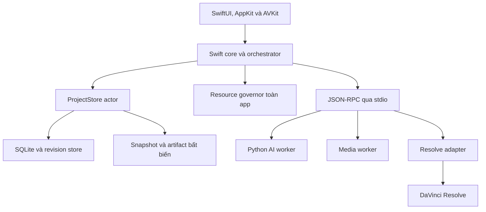

# 05 — Kiến trúc vận hành, quyền ghi, phục hồi và lộ trình triển khai

**Phiên bản đặc tả:** 3.1 · **Ngày:** 06/11/2026.  
**Trạng thái:** thiết kế để triển khai và kiểm chứng; chưa phải ứng dụng đã chạy hoặc chứng nhận độ ổn định.

Tài liệu này chốt cơ chế giữ dữ liệu đúng phiên bản và tiếp tục công việc sau gián đoạn. Hợp đồng dữ liệu ở [02-ANALYSIS-AND-DATA.md](02-ANALYSIS-AND-DATA.md); tài nguyên/model ở [03-MODELS-AND-RESOURCES.md](03-MODELS-AND-RESOURCES.md); dựng ở [04-SCRIPT-AND-EDIT.md](04-SCRIPT-AND-EDIT.md). [09-UPGRADES-AND-ACCEPTANCE.md](09-UPGRADES-AND-ACCEPTANCE.md) giữ tiêu chí nghiệm thu và [11-CODING-WORKFLOW-AND-CHECKLIST.md](11-CODING-WORKFLOW-AND-CHECKLIST.md) giữ thứ tự coding/checklist.

## 1. Stack và ranh giới có thẩm quyền

### 1.1. Kiến trúc được chọn



Giữ app macOS native bằng SwiftUI; AppKit/AVKit dùng ở nơi cần tích hợp nền tảng. **Swift core** quản lý project, dependency, queue, revision, approval và quyền publish. Python subprocess phụ trách model, media và adapter Resolve. Không chuyển sang Rust/Tauri trong MVP này.

Một app process sở hữu một resource governor chung cho tất cả cửa sổ/project. Mỗi project có đúng một `ProjectStore` actor quản lý ghi canonical SQLite; các cửa sổ của cùng project dùng chung actor. Main actor chỉ xử lý state/UI nhẹ; actor không tự chứng minh mọi I/O/inference đã rời main thread.

### 1.2. Bảng quyền

| Thành phần | Được làm | Không được làm |
|---|---|---|
| UI | Gửi command có target/revision; trình bày dữ liệu đã ACK | Tự bật cờ approval hoặc báo đã lưu trước commit |
| Swift orchestrator | Lập DAG, điều phối job, cấp/revoke attempt, kiểm gate | Dùng một câu trả lời LLM làm bằng chứng đã duyệt |
| `ProjectStore` | Commit canonical state trong transaction ngắn, cấp revisions, journal intents | Giữ transaction trong suốt inference/render |
| Worker AI/media | Đọc input refs được cấp, viết output tạm của attempt, gửi typed result | Mở canonical DB để ghi, sửa source, cấp approval |
| Resolve adapter | Thực hiện operation đã journal và nằm trong capability đã kiểm | Chạy code/lệnh tùy ý từ model, sửa project ngoài phạm vi |
| Resource governor | Cấp một heavy lease toàn app, theo dõi áp lực tài nguyên | Coi adapter chết là Resolve đã dừng render |

Model/runtime nằm ngoài app bundle theo manifest đã khóa. Worker được đóng gói/khởi chạy theo profile nền tảng đã kiểm; không yêu cầu người dùng dùng terminal trong luồng bình thường.

## 2. Canonical store, khóa project và cấu hình SQLite

### 2.1. Vị trí lưu được hỗ trợ

MVP dùng active project trên **local APFS** đã qua kiểm tra quyền và khả năng lưu bền. Nguồn gốc có thể nằm trên ổ ngoài, nhưng phân tích/render dùng managed snapshot theo tài liệu 02. Network share và thư mục database đang được đồng bộ cloud trực tiếp không nằm trong support envelope.

Mặc định đề xuất nơi app quản lý trong Application Support. Khi chọn vị trí khác, preflight kiểm filesystem, quyền, dung lượng và các vùng đồng bộ đã biết; thông báo hạn chế thay vì tự giả định mọi thư mục local đều phù hợp. Không tuyên bố có thể nhận diện mọi phần mềm đồng bộ bên thứ ba. Export/backup portable có thể được sao chép đi sau khi hoàn tất; không chạy DB đang hoạt động từ gói đang đồng bộ.

Một khóa hệ điều hành theo project ngăn hai app process cùng mở project để ghi. Marker file chỉ phục vụ chẩn đoán, không thay khóa thật. Nếu project đã có writer khác, mở read-only hoặc yêu cầu chuyển về phiên đang sở hữu; không phá khóa chỉ vì timestamp trông cũ.

### 2.2. Quy tắc database

| Hạng mục | Chính sách MVP |
|---|---|
| Journal | `journal_mode=WAL` trên cấu hình đã kiểm |
| Độ bền canonical state | `synchronous=FULL`; không tự hạ xuống để tăng tốc |
| Quan hệ | `foreign_keys=ON` cho từng connection; thêm kiểm project/scope ở store |
| Writer | Một đường commit qua `ProjectStore`; worker không có DB write handle |
| Reader | Connection/read transaction ngắn; không giữ snapshot UI vô thời hạn |
| Schema | Version dữ liệu riêng, bắt đầu ở schema 1 của bản triển khai mới; không lấy số spec 3.1 làm schema |
| Concurrency | Expected revision/fingerprint trong transaction; xung đột trả kết quả rõ ràng |
| Busy handling | Chờ có giới hạn ngoài main actor; retry hữu hạn cho transaction chưa commit, không vòng lặp vô hạn |
| Checkpoint WAL | `PASSIVE` vào thời điểm nhàn rỗi/sau đợt commit, quan sát kích thước và reader giữ lâu; shutdown theo policy đã kiểm |
| Runtime | Ghi đúng SQLite provider/version và options trong build/support manifest; kiểm lại khi thay runtime |

Policy khởi đầu cho busy handling là chờ tối đa 1 giây mỗi lần và tối đa 3 lần thử cho thao tác được xác định là retry-safe; đây là cấu hình cần đo, không là latency đã đạt. Lỗi có thể khiến UI tiếp tục hiển thị “Đang lưu” hoặc “Lưu lỗi”, không được báo “Đã lưu”. Không replay một thao tác đã có khả năng commit mà chưa tra idempotency record.

WAL tăng không kiểm soát phải tạo finding và xử lý reader/checkpoint/disk pressure. Không xóa file WAL bằng thao tác file thủ công. WAL/transaction SQLite không tạo atomicity chung với file artifact hoặc Resolve; hai miền đó dùng protocol riêng dưới đây. Các nguyên tắc WAL cần được đối chiếu với [tài liệu SQLite](https://www.sqlite.org/wal.html) của runtime thực được khóa.

## 3. Trạng thái project và dependency DAG

### 3.1. Mốc hiển thị của project

`source_ready → analyzed → review_ready → facts_ready → scripts_ready → script_approved → preview_ready → preview_approved → final_rendered → done`.

Các mốc này mô tả revision đang làm việc, không phải một hàng đợi tuyến tính buộc mọi job đợi nhau. Project có thể vừa có kết quả một phần, vừa có review, vừa phân tích clip khác. Lịch sử final cũ vẫn mở được khi người dùng tạo revision mới; nó không cấp quyền gọi revision mới là `done`.

- Source có lỗi/quyền thiếu được giữ trong manifest; phần sẵn sàng có thể được xử lý độc lập.
- Một critical review chỉ chặn claims/concepts/artifacts cần nó. Unknown hoặc bỏ claim có thể mở một góc kể khác.
- Script candidate chỉ trình là khả thi sau TTS thử và kiểm cut theo đúng trạng thái tìm kiếm ở tài liệu 07.
- Chọn script không phải script approval; script approval không thay preview approval.
- Final render xong không phải `done`; final gate phải kiểm chính bytes/revision final và các gate hiện hành.
- Việc thêm source tạo impact revalidation theo corpus scope; không chỉ đi theo cạnh phụ thuộc cũ.

### 3.2. Hợp đồng một job

Mỗi logical job có loại, project/scope, input refs bất biến, input fingerprint, dependencies, output contract, mức tài nguyên, retry policy và idempotency key. Attempt là lần thực thi riêng của job, không phải revision tùy ý của cùng đầu vào.

DAG artifact/job không được có chu trình; validate trước khi enqueue. Event chronology graph có quy tắc riêng ở tài liệu 02, không dùng cùng validator một cách máy móc. Bước cần tương tác người dùng tạo blocked dependency có lý do; không giữ process nặng để chờ câu trả lời.

| Trạng thái job | Ý nghĩa | Điều kiện ra trạng thái |
|---|---|---|
| `queued` | Đã có intent và đủ mô tả; chờ dependencies/resource | Preflight phù hợp và được scheduler chọn |
| `preparing` | Kiểm input, capability, disk và quyền attempt | Có lease/input refs hợp lệ trước chạy |
| `running` | Attempt hiện hành đang làm việc | Có kết quả, checkpoint, yêu cầu dừng hoặc lỗi |
| `pause_requested` | Đã nhận yêu cầu; worker chưa được coi đã dừng | Checkpoint hợp lệ và hoạt động nặng thực đã dừng |
| `paused` | Có điểm tiếp tục, không chiếm heavy lease | Resume tạo attempt/quyền thực thi phù hợp |
| `blocked_review` | Thiếu quyết định người dùng cần cho job | Review/claim use đủ điều kiện hoặc thay nhánh |
| `blocked_resource` | Thiếu RAM/disk/capability/Resolve rảnh | Kiểm lại điều kiện; không âm thầm giảm chất lượng |
| `needs_relink` | Input bắt buộc thiếu/hỏng/quyền không còn | Phục hồi đúng source revision hoặc tạo revision mới |
| `reconciling` | Kết quả side effect/chạy trước chưa rõ | Có bằng chứng trạng thái thực; không replay mù |
| `cancel_requested` | Quyền publish bị revoke; đang dừng/thu hồi | Xác nhận tiến trình và side effect đã xử lý an toàn |
| `succeeded` | Outputs của đơn vị job đã commit đúng contract | Không tự suy ra project đã đạt chất lượng |
| `failed` | Lỗi cụ thể được ghi; không còn attempt hợp lệ đang chạy | Retry có điều kiện bằng attempt mới hoặc sửa đầu vào |
| `cancelled` | Đã dừng và mất quyền publish; giữ lịch sử | Muốn làm lại phải có command/job hợp lệ mới |
| `stale` | Đầu vào/dependency không còn phù hợp revision hoạt động | Không sửa input tại chỗ; tạo job cho đầu vào mới |

## 4. IPC chuẩn: JSON-RPC 2.0 qua JSON Lines stdio

### 4.1. Quy tắc transport

Chọn một transport cho MVP: **UTF-8 JSON Lines trên stdin/stdout của subprocess**, dùng envelope JSON-RPC 2.0. Không mở port TCP, không đồng thời duy trì Unix socket và stdio để tăng số đường lỗi.

- Stdout chỉ chứa protocol; một JSON message trên một dòng, ký tự xuống dòng trong text được escape đúng JSON.
- Stderr là log chẩn đoán có buffer/quota; thư viện in log ra stdout phải được cấu hình/bao lại trước khi được nhận làm worker.
- Giới hạn ban đầu 1 MiB/message theo bytes UTF-8, không phải số ký tự. Ảnh/audio/tensor/JSON lớn đi qua artifact refs được core kiểm.
- JSON parser kiểm kiểu, enum, kích thước, integer range và method allowlist; không thực thi lệnh lấy từ text của model.
- I/O đọc stdout/stderr không chặn main actor. Progress có thể gộp theo job; terminal result/error/ack không bị bỏ như progress.
- Hàng đợi/buffer có giới hạn và backpressure. Worker vi phạm kích thước/protocol mất quyền attempt; giữ chẩn đoán đủ dùng và báo lỗi có phạm vi.
- Core kiểm ref nằm trong attempt root được cấp, không đi qua symlink/path traversal ra ngoài; worker không tự chọn output path canonical.

### 4.2. Handshake và phiên chạy

Trước job đầu tiên, `worker.hello` trao đổi protocol version, worker kind/version/build, runtime/backend revisions và capabilities. Core kiểm với manifest đã khóa. Version không tương thích thì không gửi job và không diễn giải payload theo phỏng đoán.

`run_session_id` do core tạo mới cho mỗi phiên app/khôi phục; nó kết hợp với fencing token để loại kết quả từ phiên cũ. Không dùng PID đơn lẻ làm danh tính vì PID có thể được tái sử dụng.

| Field cho job command/result | Quy tắc |
|---|---|
| `request_id` | Trùng JSON-RPC `id` của request có response; notification có event ID riêng |
| `idempotency_key` | Danh tính logical command bền; retry cùng lệnh giữ key |
| `project_id` | Project được phép thao tác; phải khớp capability input/output |
| `expected_revision` | Target revision và dependency fingerprint cần còn hợp lệ; không mặc định chặn mọi sửa đổi không liên quan |
| `job_id` | Logical job với input contract bất biến |
| `attempt_id` | UUID riêng cho lần chạy; không tái dùng attempt đã bị revoke |
| `fencing_token` | Counter tăng được persist trước cấp quyền attempt |
| `run_session_id` | Phiên core hiện hành; token đúng nhưng session cũ vẫn bị từ chối |
| `input_refs` / `output_refs` | References đã đăng ký, có schema/size/hash/role thích hợp |

### 4.3. Ví dụ request chưa triển khai

Ví dụ chỉ mô tả shape; UUID và hash minh họa không trỏ dữ liệu thật. Handshake không cần job fields; mọi method có side effect của job thì bắt buộc mang bộ quyền tương ứng.

```json
{
  "jsonrpc": "2.0",
  "id": "request-017",
  "method": "worker.execute",
  "params": {
    "protocol_version": "1.0",
    "request_id": "request-017",
    "idempotency_key": "00000000-0000-4000-8000-000000000011",
    "project_id": "00000000-0000-4000-8000-000000000001",
    "job_id": "00000000-0000-4000-8000-000000000012",
    "attempt_id": "00000000-0000-4000-8000-000000000013",
    "run_session_id": "00000000-0000-4000-8000-000000000014",
    "fencing_token": 42,
    "expected_revision": {
      "target_revision_id": "00000000-0000-4000-8000-000000000015",
      "input_fingerprint": "aaaaaaaaaaaaaaaaaaaaaaaaaaaaaaaaaaaaaaaaaaaaaaaaaaaaaaaaaaaaaaaa"
    },
    "job_type": "analyze_window",
    "input_refs": ["registered-input-0008"],
    "attempt_output_ref": "registered-attempt-output-0013"
  }
}
```

Worker trả result có cùng job/attempt/session/fence và manifest đầu ra. “Worker hoàn thành” chỉ đưa dữ liệu tới bước kiểm/publish của core; không là canonical commit ACK.

Các method tối thiểu: handshake/capabilities, execute, request pause/cancel, inspect status và shutdown. Không có method worker `approve`, `mark_project_done` hoặc chạy mã tùy ý do LLM sinh. Khi mất response của một command, tra idempotency/journal trước gửi lại.

## 5. Attempt fencing, idempotency và resource governor

### 5.1. Cấp quyền và thu hồi

1. `ProjectStore` ghi job intent và input snapshot; cùng idempotency key nhưng payload khác bị conflict.
2. Khi scheduler sẵn sàng, store cấp attempt ID mới và tăng/persist fencing counter trong transaction.
3. Governor cấp heavy lease nếu không còn công việc nặng cũ thực sự hoạt động; chỉ sau đó mới launch worker nặng.
4. Mọi progress/result/checkpoint mang attempt/session/fence. Core chỉ nhận business result nếu bộ quyền còn hiện hành và input còn hợp lệ.
5. Cancel/stale **revoke publish permission trước**, rồi gửi yêu cầu dừng. Không chờ process chết mới đánh dấu attempt mất quyền.
6. Một attempt thay thế có ID/token mới. Kết quả muộn của attempt cũ bị từ chối/quarantine; không nhập vào canonical state.
7. Sau restart hoặc restore, session ID mới làm mọi output/connection phiên cũ mất quyền. Counter tăng trong lịch sử branch đang hoạt động; bản restore không được nhận worker của branch/phiên trước chỉ vì cùng số token.

Idempotency không đồng nghĩa “mọi lần chạy đều ra cùng bytes”. Cùng lệnh đã commit trả lại kết quả đã ghi; lệnh chưa rõ side effect phải reconcile. Một thao tác người dùng cố ý làm lại tạo command mới, không tái dùng key chỉ vì nội dung giống.

### 5.2. Một heavy lease trên toàn app

Inference model lớn, render Resolve và công việc media nặng dùng chung một governor. Decode nhẹ/thumbnail có hàng đợi riêng bị giới hạn; không tự kích hoạt model khi người dùng đổi tab.

Lease chỉ được trả khi kiểm thấy hoạt động nặng đã dừng và ngân sách bộ nhớ cho pha sau đủ. Worker cũ còn sống ngăn cấp heavy lease mới dù token của nó đã bị revoke. Adapter subprocess chết không chứng minh Resolve đã dừng render.

Governor tính UI, hệ điều hành, decoder, processor/tensors, model/KV cache, worker, Resolve idle/render và buffer. Đo memory pressure/swap thực; không lấy weights làm peak RAM. Thiếu RAM/SSD thì checkpoint/pause, không tự đổi model/voice, bỏ lượt bằng chứng hoặc xóa dữ liệu người dùng.

Nếu Resolve đang mở project/chỉnh sửa ngoài phạm vi app, giữ `blocked_resource` và giải thích hành động cần thiết. Không kill hoặc đóng project của người dùng để lấy RAM. Với project app-managed, save/đóng/chuyển pha chỉ theo lifecycle đã qua capability fixture.

### 5.3. Liveness và timeout

Heartbeat ban đầu mỗi 5 giây và nghi ngờ mất liên lạc sau 3 nhịp thiếu là policy khởi đầu để đo, không là bằng chứng process đã chết. Luồng heartbeat/control phải hoạt động độc lập với tác vụ inference dài khi backend cho phép; PID/process handle và trạng thái Resolve được kiểm riêng.

Mỗi operation có timeout/progress policy: kết nối/handshake ngắn, decode có tiến độ, inference theo cửa sổ, render theo trạng thái thực. Không dùng timeout tùy tiện để đánh dấu phân tích đạt hoặc bỏ frame. Hết budget tạo lỗi/chờ/unknown phù hợp.

Worker chạy trong process group có supervisor và đường shutdown. Parent mất kết nối/thoát phải kích hoạt cơ chế dừng worker đã được kiểm trên bản đóng gói. Có grace period rồi terminate/kill theo operation, nhưng side effect Resolve vẫn cần reconciliation trước retry hoặc cấp lease mới.

## 6. Publication: database và filesystem không phải một transaction

### 6.1. Đơn vị publication

Một publication có durable intent, job/attempt/session/fence, target artifact revision, expected dependencies, temp location, manifest outputs và trạng thái. Nó có thể chứa một nhóm blobs cùng metadata phải xuất hiện như một kết quả nghiệp vụ.

Đầu ra tạm nằm **trên filesystem đích** để đường rename đã kiểm có ý nghĩa. Worker không publish trực tiếp. Hash chuẩn là SHA-256. File cùng hash chỉ được deduplicate sau kiểm; không ghi đè blob immutable đã tồn tại bằng bytes khác.

| State | Điều đã được xác nhận | Được hiển thị như artifact dùng được? |
|---|---|---|
| `PREPARED` | Intent và quyền attempt đã persist; có contract đầu ra | Không |
| `MATERIALIZED` | Worker đóng output tạm, core nhận manifest và biết file ứng viên | Không |
| `VERIFIED` | Core kiểm schema/media/hash/path/input quyền hợp lệ; có manifest xác minh | Không, cho tới commit canonical |
| `COMMITTED` | Bytes immutable ở vị trí cuối và DB transaction tham chiếu đúng chúng đã commit | Có, trong phạm vi các gate nội dung/approval còn hiệu lực |

### 6.2. Thứ tự chuẩn

1. Commit intent `PREPARED` trước thực thi; không có durable intent thì không cho external side effect hoặc publish.
2. Worker chỉ ghi attempt temp; khi xong đóng file và gửi result. Core kiểm quyền rồi chuyển `MATERIALIZED`.
3. Core verify loại/kích thước/path, parse schema, hash và kiểm media phù hợp output contract. Metadata tự khai của worker không thay kiểm này.
4. Ghi manifest xác minh và `VERIFIED`; flush dữ liệu theo backend durability đã kiểm, `fsync` file/thư mục khi contract yêu cầu.
5. Atomic rename vào kho immutable trên cùng filesystem theo primitive đã kiểm, rồi làm bền directory entry. Không xóa bản đang được duyệt để lấy chỗ ghi tạm.
6. Trong một transaction ngắn, kiểm lại attempt/session/fence, expected revisions, input fingerprint, dependencies và bytes/manifest đã publish; insert artifact/dependency rows và đổi publication thành `COMMITTED`. Checkpoint tương ứng được ghi trong cùng transaction. Khi đây là publication cuối đủ output contract của đơn vị job, cũng ghi job completion và kết quả idempotency trong chính transaction đó; không để một cửa sổ crash giữa artifact commit và logical completion.
7. Chỉ gửi ACK cho UI/consumer sau transaction trên thành công. Các publication trung gian của job nhiều đơn vị có thể đã commit trước, nhưng chưa đủ output contract thì chưa được gắn job `succeeded`.

`COMMITTED` không được trỏ tới bytes chưa verify hoặc chưa tồn tại. Đây là invariant cần thử, không phải cam kết filesystem/hardware không bao giờ hỏng. File bị thiếu/hỏng sau commit tạo corruption finding và chặn dependents; không sửa metadata để giả vờ vẫn là artifact cũ.

Flush/rename và transaction không tạo một atomic operation xuyên hai hệ. G0 phải kiểm semantics durability trên filesystem/runtime được hỗ trợ; không hứa an toàn mất điện chỉ vì có một lời gọi `fsync`. Nếu chưa chứng minh contract cần thiết, gate chưa đạt và ghi đúng giới hạn.

## 7. Startup reconciliation và mọi cửa sổ crash

### 7.1. Thứ tự mở lại project

1. Lấy project writer lock, mở store theo phiên bản được hỗ trợ và tạo session mới.
2. Đọc journals/attempts; tất cả quyền publish của phiên cũ mất hiệu lực.
3. Kiểm worker/process group và Resolve activity còn tồn tại; chưa rõ hoạt động nặng thì chưa cấp lease mới.
4. Reconcile publication, external operations và checkpoints; không giả định mọi trạng thái `running` cũ đều chưa làm gì.
5. Kiểm integrity/refs/pins quan trọng, nguồn/artifact cần dùng và các gate còn pending.
6. Chỉ enqueue lại phần đủ điều kiện với attempt mới; trả UI trạng thái phục hồi có phạm vi.

| Điểm bị gián đoạn | Quy tắc phục hồi |
|---|---|
| Sau `PREPARED`, chưa có file | Đánh attempt cũ mất quyền; có thể tạo attempt mới nếu inputs/capability còn hợp lệ |
| Temp đang ghi dở | Giữ/quarantine tới khi xác nhận writer cũ dừng; không coi file tồn tại là đủ |
| Sau `MATERIALIZED`, chưa verify | Verify lại từ bytes; manifest tự khai chưa đủ cấp quyền dùng |
| Sau `VERIFIED`, trước rename | Đối chiếu hash/temp/final locations; tiếp tục bằng quyền mới chỉ khi kiểm đủ |
| Rename xong, DB chưa commit | Blob là orphan chưa được cấp quyền; nhận lại qua protocol hoặc GC sau policy an toàn |
| DB commit xong, ACK mất | Tra idempotency/journal và trả kết quả đã commit; không chạy lại job chỉ vì UI chưa thấy |
| Đủ publications đã commit nhưng completion record không nhất quán | Kiểm root/output contract và repair qua transaction hoặc báo invariant failure; không rerun chỉ vì `job_runs` còn `running` |
| Token bị revoke trong lúc publish | DB commit phải thất bại kiểm quyền; blob chưa tham chiếu không được thành output hiện hành |
| DB báo committed nhưng blob mất/hỏng | Chặn dependents; restore đúng bytes hoặc tạo revision mới theo approval policy |
| Resolve đã có effect nhưng journal chưa ACK | Đọc trạng thái thật theo capability; không append/render lại mù |
| Source/corpus/fact đổi khi job đang chạy | Giữ output theo input lịch sử khi cần; không dùng nó vượt gate của revision mới |

GC không chạy đua với reconciliation. Không xóa temp chỉ vì quá hạn nếu process đang ghi còn sống; không xóa blob orphan vừa rename khi publication tương ứng đang được đối chiếu.

## 8. Resolve operation journal và quyền sở hữu timeline

### 8.1. Capability profile trước mọi automation

G0 thử timeline 10 giây trên **phiên bản Resolve/API thật**, rồi ghi profile: kết nối scripting, settings, import/append, quy ước frame in/out, locator/IDs đọc lại được, track/item/effect properties quan sát được, render, export `.drp` và reopen. “21.1.2” trong khảo sát cũ không là bằng chứng máy hiện tại có phiên bản đó.

Adapter dùng allowlist các operation đã có fixture. API không đọc lại được một hiệu ứng không được xem là đã verify chỉ vì lệnh không báo lỗi. Dùng fallback sealed overlay/asset hoặc rebuild timeline cô lập đã kiểm; nếu vẫn không chứng minh đúng effect thì capability chưa đạt.

Đường dựng mặc định import conform-media artifact 24/1 đã verify, publish và pin, với mapping về PTS/frame của snapshot gốc theo tài liệu 04. Native conform trong Resolve mặc định tắt; chỉ bật ở profile đã chứng minh cùng mapping bằng fixture và job checks. Không giao một source VFR cho Resolve rồi giả định bảng mapping nội bộ đã được thực hiện.

### 8.2. Journal một side effect

Core commit `resolve_operation` intent trước call, gồm operation ID, edit-plan revision, target managed identity, precondition signature, input refs, expected effect và readback strategy. Adapter được serialize toàn app; không có hai thread/project đồng thời thay state Resolve qua adapter.

| Pha | Hành vi |
|---|---|
| Chuẩn bị | Đọc precondition, kiểm đúng managed project/timeline và không drift |
| Gửi | Ghi trạng thái đã gửi/attempt trước khi coi response là kết quả |
| Quan sát | Đọc IDs/signatures/status thực, cả khi response timeout hoặc mất |
| Xác minh | So effect với intent trong phần API capability thực quan sát được |
| Commit | Lưu kết quả canonical và operation effect refs; ACK idempotency |
| Không kết luận được | `reconciling`/blocked, giữ intent; không replay để “thử xem” |

`operation_id`, timeline locator và signatures cần được thiết kế để tìm lại effect khi crash ngay sau append. Tên timeline một mình không đủ làm danh tính. Nếu API không cung cấp locator/marker bền theo profile đã thử, adapter phải dùng phương án cô lập/rebuild mới đủ kiểm chứng hoặc chặn capability.

Rollback SQLite không rollback Resolve. Một operation append có thể đã xảy ra trước khi worker chết; một render có thể còn chạy khi adapter đã mất kết nối. Chỉ phát hành operation mới sau khi effect/status cũ được giải quyết.

### 8.3. Managed timeline và manual handoff

- Mỗi edit-plan revision có identity project/timeline app-managed xác định được. Tạo timeline revision mới thay vì phá timeline đang có chỉnh sửa.
- App-managed timeline là phần automation có thẩm quyền; chỉ nó được dùng cho pipeline final đã duyệt.
- Bản manual handoff là bản sao/project export riêng để người dùng sửa trong Resolve. MVP không nhập ngược các sửa tay này vào edit plan tự động.
- Khi managed timeline có drift, block export; cho giữ bản đó thành manual branch hoặc tạo managed revision mới từ sealed inputs. Không ghi đè chỉnh tay để làm signatures khớp.
- Kiểm trước và sau render, đồng thời QC file final. Người dùng chỉnh managed timeline trong lúc job chạy làm job không còn hợp lệ theo contract.
- Fingerprint chỉ bao phủ các property profile thực đọc được; không tuyên bố kiểm toàn bộ hiệu ứng dựa trên một hash không chứa chúng.
- Chỉ save/đóng project app-managed theo lifecycle được kiểm. Không đóng project khác hoặc kill Resolve đang có sửa tay chưa lưu.

Khả năng chỉnh sửa được công bố theo lớp: clip/audio/cut riêng track, title/caption native nếu capability có, raster overlay chỉ sửa timing hoặc tái sinh từ nguồn text/style. Không gọi chữ raster là text sửa trực tiếp trong Resolve.

## 9. Approval, bytes đã duyệt và thay đổi khi job đang chạy

Approval logic thực hiện trong core, không phụ thuộc view đang mở. Command sửa/xác nhận/duyệt mang entity ID, revision người dùng đã xem và dependency fingerprint cần thiết. Core kiểm trong transaction; expected revision sai thì trả conflict và diff, không duyệt một bản khác thay người dùng.

Script approval gắn script/claim/fact use decisions/storyboard/constraints và voice thử có liên quan. Preview approval gắn preview/edit plan cùng bytes voice/graphics, crop, chữ, timing, mix và render profile đã hiển thị. Không yêu cầu approval sớm tham chiếu artifact tương lai chưa sinh.

Nguồn/voice/graphics đã duyệt được giữ nguyên bytes và pin. Cùng seed/config/prompt không chứng minh tái sinh cho ra cùng output. Rerender từ snapshot đã được phép dùng lại media đó; thay đổi có ý nghĩa tạo revision mới và stale đúng approval phụ thuộc.

Khi user sửa trong lúc worker chạy, output phải kèm input revisions. Core có thể lưu kết quả lịch sử/đề xuất cũ để so sánh nhưng không áp vào nền mới. Pending corpus impact được kiểm trước final; thêm clip không làm stale mù toàn project nhưng cũng không được bỏ qua chỉ vì chưa có dependency edge cũ.

Nếu revalidation kết luận `no_material_change`, giữ nguyên approval ID, snapshot và input fingerprint cũ; một impact decision mới liên kết scope trước/sau là căn cứ gỡ pending block. Không cập nhật fingerprint của approval để giả vờ nguồn mới đã được duyệt. Nếu nội dung hoặc dependency thực được dùng đổi, tạo artifact revision mới và stale approval liên quan.

Final gate kiểm ít nhất:

1. Edit plan/source/media refs đúng revision, hash và capability profile.
2. Script/preview approvals cần thiết còn hiệu lực; không có critical review hoặc impact check liên quan chưa xử lý.
3. Managed Resolve state không drift trong phạm vi được hỗ trợ và job được reconcile đầy đủ.
4. File final đã commit, đạt QC riêng về container/codec/timebase/duration/hình/âm/chữ/crop và nội dung theo profile.
5. MP4, báo cáo, manifests và project/backup Resolve bắt buộc tồn tại, mở lại được theo gate nghiệm thu.

Profile resolution/codec final có thể khác preview theo hợp đồng công bố, nhưng không được thay nội dung/timing ngoài scope duyệt. Sửa punchline, shot, voice, mix hoặc layout không phải “refresh cache”.

## 10. Backup nhất quán và khả năng restore thật

### 10.1. Hai loại backup phải hiển thị đúng tên

| Loại | Bao gồm | Điều kiện khôi phục |
|---|---|---|
| `checkpoint_backup` | SQLite snapshot nhất quán, root manifests, notes/facts/resolutions/approvals, config/runtime manifest và các refs cần giữ | Có thể thiếu source/model weights; phải liệt kê đúng prerequisite, không gọi portable đầy đủ |
| `portable_backup` | Nội dung checkpoint, referenced sealed media/artifacts, nguồn text/style cần tái sinh và Resolve export đã có của revision | Có dữ liệu project để mang sang nơi khác; runtime/model manifest luôn có, weights chỉ kèm nếu chọn bundle rõ ràng |

Nếu project chưa tạo timeline/render, manifest ghi artifact đó chưa được tạo, không giả lập `.drp`. Với revision đã có đầu ra Resolve, portable backup phải chứa export đúng revision hoặc báo backup chưa đủ điều kiện hoàn tất.

### 10.2. Tạo backup

1. Core lập write barrier, đợi transaction canonical đang chạy hoàn tất và tạm dừng canonical writes **trước khi** chọn root hoặc tính reference closure.
2. Trong cùng cửa sổ snapshot nhất quán, chọn committed root revision, tính closure, ghi backup intent/pins và chụp SQLite bằng Backup API/cơ chế đã kiểm. DB snapshot, root revision, manifest/ref closure và pin set phải thuộc cùng snapshot logic; không chọn root R rồi backup DB đã có nội dung R+1. Không copy tùy tiện chỉ file `.sqlite` khi WAL đang hoạt động.
3. Khi DB snapshot và thông tin định danh/closure đã được giữ an toàn, bỏ write barrier để tiếp tục chỉnh revision mới. Copy media và Resolve export chạy sau, dùng root/immutable refs đã pin; không giữ write barrier qua toàn bộ việc đóng gói lớn và không trộn artifact mới vào manifest cũ.
4. Copy/đóng gói immutable refs, runtime/model manifests và Resolve export phù hợp. Adapter serialize export; managed revision được backup không bị mutate.
5. Ghi schema version, project/root revisions, policy, hashes, loại backup, phần bị lược bỏ và restore prerequisites.
6. Verify gói backup, publish manifest sau cùng theo protocol; chỉ báo thành công khi có validation report.

Đối chiếu cơ chế snapshot với [SQLite Online Backup API](https://www.sqlite.org/backup.html). “Có bản sao database” không thay bằng chứng khôi phục được media, facts, approvals và project.

### 10.3. Lịch và retention ban đầu

- Tạo checkpoint user-state tại các ranh giới fact/script/preview approval quan trọng và trước migration.
- Mục tiêu checkpoint định kỳ 15 phút khi đang biên tập chủ động; đây là policy cần đo, không phải mức mất dữ liệu đã được chứng minh.
- Autosave draft có ACK vẫn là cơ chế chính giảm mất phần đã gõ; backup không bảo vệ text còn ở buffer chưa commit.
- Policy khởi đầu giữ 24 checkpoint định kỳ gần nhất và các checkpoint còn pin bởi revision/approval cần giữ. Portable backup không tự xóa như cache.
- Xóa backup theo retention phải tính lại reference/pin graph trước; không làm orphan artifact của backup khác hoặc project đang hoạt động.
- Thiếu disk báo lỗi/chờ có hành động; không xóa source, approval hoặc backup được giữ để lặng lẽ đạt một lần backup mới.

### 10.4. Restore

Restore luôn vào **thư mục mới**, giữ nguyên project/gói backup gốc. Kiểm manifest hashes, `integrity_check`, `foreign_key_check`, schema compatibility, refs, declared omissions và các prerequisite.

Project restore giữ lịch sử/IDs; không cho hai bản cùng `project_id` đồng thời ghi như một project duy nhất. Mở bản cũ read-only hoặc dùng thao tác fork riêng có provenance nếu cần hai nhánh hoạt động.

Mở bằng session mới, revoke quyền attempt cũ, reconcile pending operations và chỉ resume từ checkpoint đã xác minh. Không gửi lại Resolve side effect lấy từ backup chỉ vì journal nói `running`.

Chỉ gọi restore đầy đủ khi kiểm được facts/resolutions/approvals/artifacts và khả năng mở project theo loại backup. Thiếu source/model/runtime được hiển thị như prerequisite cần giải quyết, không báo “khôi phục hoàn toàn”. Có fixture restore sang thư mục sạch và kiểm reopen Resolve ở cổng phát hành.

## 11. Migration và compatibility dữ liệu

Mỗi migration có ID/version, preconditions, checksum code, thao tác forward, cách tiếp tục sau crash và output validation. Không dùng `schema_version` trong JSON tùy ý để tự nâng database.

Quy trình bắt buộc:

1. Kiểm app/runtime hỗ trợ schema hiện hành và còn đủ disk; không chạy worker/job mới trong lúc nâng schema.
2. Tạo backup trước migration và kiểm backup đó đọc được; chưa có backup hợp lệ thì dừng nâng dữ liệu người dùng.
3. Ghi migration intent/journal với from/to version và input root.
4. Migration DB thuần thực hiện trong transaction phù hợp. Bước di chuyển/tái tạo file dài dùng staging/journal/publication riêng, không giữ transaction qua xử lý dài.
5. Chỉ chuyển schema version khi dữ liệu mới và refs đã validate. Crash giữa chừng được rollback transaction hoặc tiếp tục journal theo fixture, không suy từ tên thư mục.
6. Chạy integrity/FK/manifest checks và các invariants liên quan; lưu kết quả thực.
7. Nếu thất bại, giữ trạng thái cần phục hồi; khôi phục bản sao vào thư mục mới hoặc mở dữ liệu cũ theo cơ chế đã kiểm, không ghi đè bản duy nhất.

App cũ gặp schema mới chưa hỗ trợ phải block với giải thích hoặc mở chế độ read-only chỉ khi reader được chứng minh tương thích. Không tự downgrade, không ghi những trường mình không hiểu và không đề xuất xóa database để mở lại.

## 12. Cache, pins và garbage collection

Tách `cache` tái tạo được khỏi source/artifact bất biến. Blob có thể được chia sẻ theo hash trong phạm vi chính sách nhưng reference của từng revision vẫn giữ. Hash trùng không xóa provenance của hai asset logic.

GC có hai pha: lập candidate từ reference/pin snapshot, rồi trong canonical transaction kiểm lại zero-reference/zero-pin, ghi `gc_operations` intent và đặt reservation `gc_pending` cho đúng blob/inventory generation. Candidate đã được publication/backup/job mới pin thì bỏ khỏi lượt dọn. Một phép check rồi thả transaction trước unlink, không có reservation, không đạt contract.

Khi `gc_pending`, store không cho tạo reference/pin mới tới blob đó. Consumer phải chờ hoặc yêu cầu rescue; chỉ gỡ reservation sau khi hủy operation an toàn và kiểm bytes còn đầy đủ, hoặc sau một publication mới có quyền. Job/reader cần bytes phải pin trước khi sử dụng; không đọc rồi mới báo mình cần giữ blob.

Filesystem unlink diễn ra ngoài DB nhưng nằm trong journal có owner/session và generation; không replay một operation cũ lên blob vừa được publish lại. Sau unlink/flush thành công mới commit inventory tombstone và kết thúc journal. Crash trước/sau unlink được reconciler đối chiếu file/journal/hash trước khi cho phép reference mới; lỗi unlink giữ reservation có lý do hoặc rescue có kiểm, không giả báo đã dọn. Audit ghi bytes/refs đã dọn và lý do.

Mặc định tự dọn thumbnail/proxy/cache temp không còn dùng và attempt temp của process đã xác nhận dừng. Không tự dọn committed source, user notes, resolutions, approvals hoặc bản đã duyệt như cache. Dọn revision cũ cần retention policy rõ, không còn references/pins và không làm mất khả năng restore mà UI vẫn tuyên bố giữ.

Thống kê disk gồm original ngoài app, snapshot clone/copy và tăng trưởng COW, proxy, evidence frames, voice, render tạm/final, `.drp` và backup. Không báo số bytes weights như tổng nhu cầu SSD.

## 13. Đóng app, sleep/wake và quyền file

`Cmd+W` có thể đóng cửa sổ trong khi app tiếp tục job theo lựa chọn đã hiển thị; không ngầm hủy hoặc nhân đôi job. `Cmd+Q` flush draft cần lưu, chờ commit ACK hoặc hiển thị lỗi, yêu cầu checkpoint/dừng và thu hồi worker theo lifecycle hữu hạn. Không chỉ dựa `applicationWillTerminate` để lưu mọi thứ.

Sau sleep/wake kiểm lại source snapshot/ổ đĩa, quyền, worker/session, lease, memory pressure và Resolve state. Không hứa phân tích chạy tiếp khi gập máy. Không tự sửa cấu hình điện toàn hệ thống để giữ máy thức.

Quyền file của UI và worker đóng gói phải được thử thật. Truyền pathname không tự cấp quyền cho subprocess. Security-scoped bookmarks và stale bookmark, khi áp dụng sandbox profile, đi theo [hướng dẫn App Sandbox của Apple](https://developer.apple.com/documentation/security/accessing-files-from-the-macos-app-sandbox); profile được hỗ trợ phải ghi trong ma trận G0.

Không tự đọc/ghi project ngoài quyền đã chọn hoặc mở lệnh hệ thống lấy từ metadata/brief. Offline sau setup là invariant; loader thiếu dependency báo lỗi/cài đặt riêng, không gọi cloud AI làm fallback.

## 14. Modules và hướng phụ thuộc

| Module | Trách nhiệm | Đầu vào/đầu ra có thẩm quyền |
|---|---|---|
| `app-macos` | Điều hướng, editor, evidence, review, diff, progress | Typed commands/view state có revision |
| `core` | Orchestrator, gate, scheduler, resource governor, IPC | Job intents và quyết định điều phối |
| `store` | ProjectStore, schema/migration, transactions, journals, pins | Canonical state và commit ACK |
| `media` | Acquisition, metadata, PTS, maps, proxy, decode | Sealed input refs và manifests |
| `analysis` | ASR/VLM/SED capability, observations, evidence, graph, audits | Typed proposals/results; không tự commit |
| `workday` | Brief parsing, draft facts, scoped confirmation, resolutions | Fact/review revisions qua store |
| `story` | Concepts, claim uses, constraints, shot candidates, search | Script/edit-plan proposals và diagnostics |
| `audio`, `graphics` | TTS/check/alignment/mix, crop/chữ/cue | Immutable media bytes có policy revision |
| `resolve` | Capability probe, operation journal adapter, managed/handoff | Observable effect refs và reconciliation |
| `quality` | Deterministic/content QC, findings, final gate inputs | Findings có loại/phạm vi; không thay user approval |
| `recovery` | Publication reconcile, backup/restore, GC coordination | Reports và recovery commands qua store |

Tên module có thể điều chỉnh trong code nếu giữ nguyên boundaries. Không tạo một model riêng cho mỗi module chỉ vì có một tên vai trò. Business rules có một implementation có thẩm quyền, không viết lại khác nhau trong UI, Python và prompt.

## 15. Roadmap theo gate kiểm chứng

| Gate | Phạm vi | Bằng chứng cần có trước đi tiếp |
|---|---|---|
| **G0 — Platform spike** | `.app` arm64 đóng gói tối thiểu, IPC/worker permissions/offline, SQLite/filesystem profile, model/runtime sample, Resolve 10 giây | Chạy trên máy mục tiêu thật; `.drp` reopen; biết API/codec/OS/runtime nào hỗ trợ; không suy từ tên phiên bản |
| **G1 — Data và recovery** | Schema, snapshots, ProjectStore, jobs/fencing, publication, backup/migration | Fault injection từng cửa sổ crash; stale attempt không publish; restore giữ user state; không duplicate side effect |
| **G2 — Analysis và evidence** | Full-frame baseline, manifests, brief/facts, support/use decisions, corpus/review | Dữ liệu gán nhãn và held-out đúng phạm vi; coverage thực, verifier false accept, omission và RAM đã đo |
| **G3 — Story và script approval** | 1–3 concept, TTS thử, beam/candidate search, locks, script approval | Search status trung thực; hard constraints; thời lượng/shot hợp lệ; approval đúng revision |
| **G4 — Preview và approval** | Managed Resolve timeline, crop/caption/mix/cue, preview QC và duyệt | Đối chiếu source/script; xử lý drift; bytes voice/graphics được giữ; preview revision rõ |
| **G5 — Final, restore và phát hành** | Final QC, backup portable/reopen, UI hoàn thiện, offline, soak/fault suite | Không violation invariant trên suite đã công bố; support envelope có evidence; báo hạn chế và kết quả đo thực |

Packaging/worker rights và Resolve spike nằm ở **G0**, không để tới cuối mới phát hiện stack không chạy được trên Mac. UI hoàn chỉnh không đi trước chứng minh năng lực dữ liệu/model/media. Sáu nâng cấp ở tài liệu 09 đi qua capability gate riêng; có tên module không có nghĩa đã hoàn thành.

Mỗi gate có một evidence record: commit/build, máy/OS/runtime/model revisions, dataset/seed/profile, lệnh/cách chạy, kết quả, log/artifact hashes và hạn chế. Check trong Markdown chỉ được đánh hoàn tất sau evidence; các checkbox ban đầu ở tài liệu 11 để trống.

## 16. Những phép thử phục hồi có ý nghĩa

| Mã nhóm/yêu cầu | Fixture bắt buộc |
|---|---|
| `DATA-01` | Replace/append source lúc acquisition, source cùng tên khác bytes, snapshot corruption, disk thiếu khi copy |
| `DATA-02` | Kill trước/sau mỗi publication state, rename trước DB commit, ACK mất, pin thay khi GC đang lập candidate |
| `DATA-03`, `DATA-04` | Hai cửa sổ sửa/duyệt cạnh nhau, double click, same key khác payload, writer lock ở app process thứ hai |
| `DATA-05` | Clip mới làm đảo support, bổ sung bằng chứng trước đây không tìm thấy, thay corpus khi render |
| `DATA-06`, `DATA-07`, `DATA-08` | Backup trong editing, restore thư mục mới, migration bị ngắt, app cũ mở schema mới, retention không làm orphan |
| `JOB-01`, `JOB-02` | Attempt cũ gửi result sau cancel/restart; worker không chịu dừng; adapter chết khi Resolve vẫn render |
| `JOB-03`, `JOB-04`, `JOB-05` | Pause/resume tại checkpoint, IPC malformed/oversize/stdout bẩn, memory/disk pressure không làm mất dữ liệu |
| `RES-01`, `RES-02` | API khác profile, crash ngay sau append/call-before-ACK, effect không quan sát được thì không retry mù |
| `RES-03`, `RES-04`, `RES-05` | Managed timeline drift/manual edits, pre/post-render verification, manual handoff, khả năng sửa từng lớp |
| Nhóm `OFF-*`, `UI-*`, `REL-*` | Mất mạng sau setup, sleep/wake/rút ổ, Release `.app`, input tiếng Việt, soak tới thời gian chạy dài nhất được hỗ trợ |

Không dùng test chỉ khẳng định enum tồn tại để thay fault injection hành vi. Không tạo kết quả pass giả từ việc tài liệu mô tả đúng. Tolerances và mục tiêu định lượng do tài liệu 09 quản lý, với dataset/version được khóa trước held-out.

## 17. Definition of done

Một bản phát hành trong envelope công bố hoàn thành khi người dùng nhập/chọn tư liệu, bổ sung brief, xử lý review cần thiết, duyệt script và preview, rồi nhận final đã QC cùng project Resolve/backup có thể mở lại; tất cả trên cấu hình đã kiểm và offline sau setup.

Phải giữ dữ liệu đã commit qua các gián đoạn trong suite, từ chối stale attempt/approval, không sửa source gốc, không duplicate timeline và không dùng manual edits ngoài quyền như thể đã được duyệt. Trường hợp chưa đủ bằng chứng/capability/resource có trạng thái dừng rõ và đường tiếp tục hợp lệ.

Độ ổn định không được suy ra từ Swift, Python, SQLite WAL, số lần retry hoặc một con số điểm tài liệu. Chỉ báo điều đã đo trên build, máy, dữ liệu và phạm vi thực; các rủi ro còn lại được ghi ở [06-DECISIONS-AND-RISKS.md](06-DECISIONS-AND-RISKS.md).
